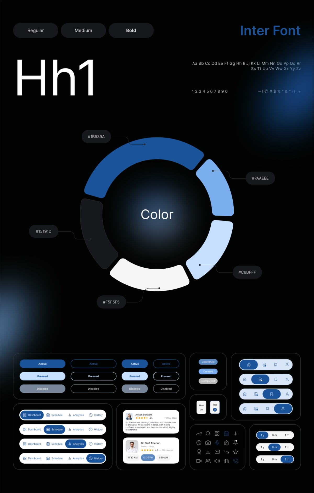
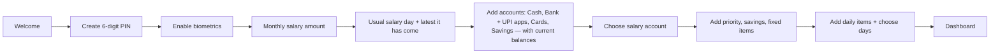
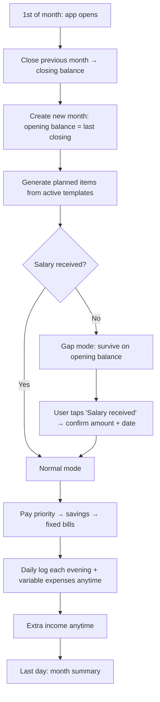
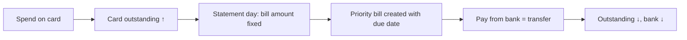
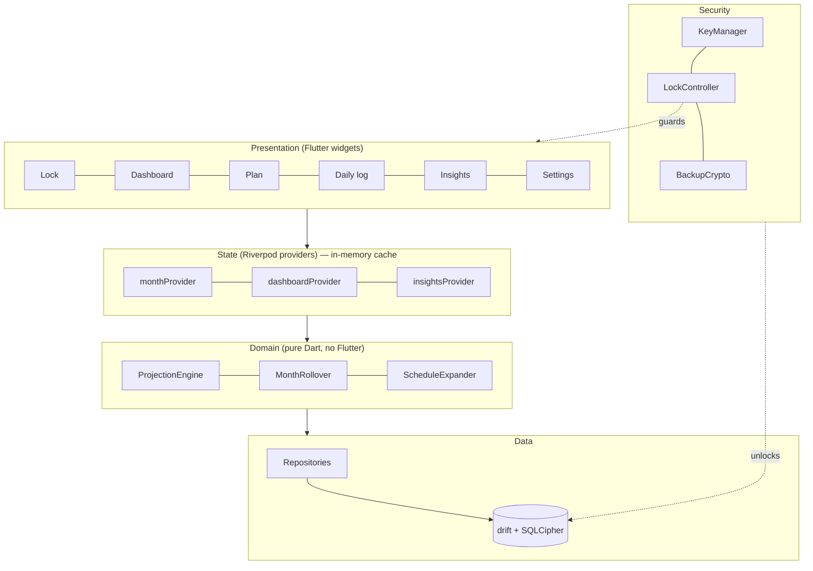
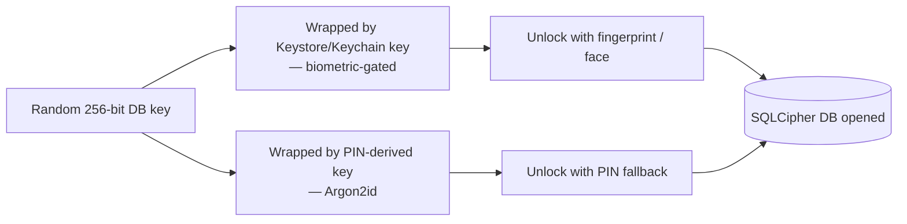

# BRUNT — Project Plan

> **BRUNT** takes the brunt of your month — bills, debts, daily costs — so you always know what's truly left to spend. A private, fully offline monthly money planner that tells you one thing clearly: **will this month make it?**
>
> Tagline: *Your money. Your phone. Nowhere else.*

**Name check:** confirm "BRUNT" availability on the Play Store, App Store and for a domain before release (a suffix like *BRUNT Money* works if the plain name is taken).

**Design reference:** `design-reference.png` (keep it in `/docs` of the repo).



---

## 1. Product Summary

| Item | Decision |
|---|---|
| Platform | Android + iOS (single codebase) |
| Data location | 100% on-device, encrypted. No server, no cloud, no analytics |
| Period | Calendar month (1st → last day) |
| Salary | Fixed amount per month, marked "received" manually on whatever day it arrives |
| Default frequency | **Monthly** for everything; **Daily** only when the user chooses it |
| Accounts | Multiple, fully customisable: cash in hand, bank, UPI, wallets, credit cards, savings. Every entry is deducted from a chosen account |
| Currency | ₹ INR (stored as integer paise) |
| Theme | Dark only, blue accent, blurred gradient glows |
| Font | Manrope (bundled locally) |

---

## 2. The Money Stack

Every month, money is allocated in this fixed priority order. The dashboard ring visualizes these tiers (like the colour ring in the reference).

| Tier | Name | Examples | Frequency default | Ring colour |
|---|---|---|---|---|
| 0 | **Income** | Salary (fixed), extra income (bonus, refund, side work) | Monthly | — |
| 1 | **Priority** | Credit card bill, loan EMI, debts | Monthly | `#1B539A` |
| 2 | **Savings** | RD, SIP, emergency fund | Monthly | `#7AAEEE` |
| 3 | **Fixed bills** | Rent, phone, internet, subscriptions | Monthly | `#C6DFFF` |
| 4 | **Daily** | Bus fare, food, tea | Daily (custom days) | `#F5F5F5` |
| 5 | **Variable** | Groceries, shopping, misc | Monthly budget | `#3A4048` |

Users can create, rename, recolour and reorder categories inside each tier. Tier order itself is fixed, because it drives the projection logic.

### 2.1 Accounts — where the money lives

Categories say **what** money was spent on; accounts say **where it came from**. Every expense, income and bill payment is linked to one account, and that account's balance updates instantly.

| Account type | Examples | Holds balance? | Counts as spendable? |
|---|---|---|---|
| **Cash** | Cash in hand, office drawer cash | Yes | Yes |
| **Bank** | HDFC Savings, SBI Salary account | Yes | Yes |
| **UPI** | GPay, PhonePe, Paytm UPI | No, linked to a bank account | Via its bank |
| **Wallet** | Paytm wallet, Amazon Pay balance, metro card | Yes | Yes |
| **Credit card** | ICICI Amazon Pay card | Shows **outstanding due** (a liability) | No; it creates a future bill |
| **Savings** | RD, FD, emergency fund, SIP | Yes | No (protected) |

**Fully customisable:** add, rename, choose icon and colour, reorder, archive, and set each account's starting balance. Every account has an **"Include in spendable balance"** toggle, so the user decides what counts as money available to spend.

**UPI handling:** a UPI entry is a payment method linked to a bank account. Paying by GPay deducts from the linked bank, but history still shows "via GPay", so you can see how much goes through each app.

**Credit card handling:** card spends do **not** reduce cash right away. They increase the card's outstanding amount, which automatically becomes a **Priority (tier 1) bill** on the card's due day. Each card stores its limit, statement day and due day, and shows used/available limit.

**Transfers** move money between accounts and are **not** counted as spending:

| Transfer | From → To |
|---|---|
| ATM withdrawal | Bank → Cash |
| Credit card bill payment | Bank → Credit card (reduces outstanding) |
| RD / savings deposit | Bank → Savings |
| Wallet top-up | Bank → Wallet |
| Cash deposit | Cash → Bank |
| Borrowed from someone | *Borrowed* (system liability account) → Bank; a one-time "Pay back X" Priority item is scheduled on the chosen date and paying it is Bank → *Borrowed* |
| Lent to someone | Bank → *Lent out* (system asset account, not spendable) with a due-back date in the note; money coming back is *Lent out* → Bank |

**Balance correction:** if real cash in hand doesn't match the app, "Adjust balance" sets the true amount and records the difference as an *Unaccounted* entry, so totals stay honest.

---

## 3. Fully Customisable Schedules

Every recurring item is a **template**. Monthly is the default; daily is opt-in.

| Field | Options |
|---|---|
| Frequency | `monthly` (default) · `daily` · `one_time` |
| Days of week (daily only) | Any combination of Mon–Sun. **Default: all 7 days, including Sunday** |
| Day of month (monthly only) | A due day (e.g. 5th) or "anytime this month" |
| Default amount | e.g. ₹40 |
| Default account | e.g. bus fare → Cash, rent → Bank via UPI, Netflix → Credit card. Changeable on each entry |
| Variable amount | On/off. If on, the app learns the real average from your logs |
| Start / end month | Optional (e.g. an EMI that ends in March 2027) |
| Active | Pause without deleting |

**Example:** Bus fare ₹40, daily, Mon–Sun → user can untick Sunday any time, or keep it. Holiday/leave days can be skipped from the daily log with one tap.

---

## 4. Feature Flows

### 4.1 First launch (onboarding)



### 4.2 Month lifecycle



Month rollover runs **on app open** (idempotent: it checks "does a month record exist for today's month?"), so no background job is needed.

### 4.3 Salary received
1. Dashboard shows a "Salary pending" card with expected amount.
2. Tap → bottom sheet with amount (pre-filled, editable), date (default today) and **account** (default: salary account).
3. Confirm → salary locked for the month and added to that account; gap check disappears; projection recalculates.

### 4.4 Paying planned items (priority / savings / fixed)
1. "Plan" tab lists the month's planned items grouped by tier, with status chips: **Pending · Paid · Skipped**.
2. Tap → mark paid (amount editable, e.g. credit bill was ₹8,240 not ₹8,000) and pick the **paying account** (pre-selected from the template).
3. Credit card bills and RD deposits are recorded as **transfers** (Bank → Card, Bank → Savings), so they move money without being double-counted as spending.
4. Overdue items (past due day, unpaid) are highlighted.

### 4.5 Daily quick log
1. Notification at user-chosen time (default 9 PM): "Log today's expenses".
2. Screen shows the date strip (Mon 20 · Tue 21 … like the reference) and today's daily items.
3. Each item: **✓ As usual** · **Edit amount** · **Skip**. Each shows its account (e.g. "Cash"); tapping the account chip changes it for that day.
4. Missed days stay "unconfirmed"; projection assumes the usual amount until confirmed.

### 4.6 Add expense / extra income / transfer
Floating `+` button → sheet with segment: **Expense | Income | Transfer** → amount, category, **account chips** (Cash · HDFC · GPay · Card …), date, note.
The app remembers the last account used per category (groceries → GPay), so the common case is still two taps. Transfer mode shows **From → To** account pickers instead of a category.

### 4.7 Insights
Period selector (1m · 3m · 6m · 1y, styled like the reference pill switch): average spend per category, savings rate, daily average, salary arrival history ("usually 3rd, latest 7th"), projection accuracy.

### 4.8 Backup & restore
Settings → Export encrypted backup (password) → saved via system share sheet / file picker. Restore reverses it after PIN/biometric check.

### 4.9 Accounts management
1. **Accounts** tab shows every account as a card: balance (or outstanding + available limit for cards), this month's in/out, and a mini trend.
2. Top summary: **Spendable total** · **Savings total** · **Card dues** · **Net worth** (assets − card dues).
3. **+ Add account** → type, name, icon, colour, starting balance, "include in spendable" toggle. Cards also ask limit, statement day, due day. UPI asks which bank it's linked to.
4. Tap an account → its own transaction history, edit, adjust balance, archive (archiving keeps history; delete only allowed if no entries).
5. Drag to reorder; the order is used in every account picker.

### 4.10 Credit card cycle


---

## 5. Projection Engine

All maths runs in a pure Dart module (`domain/projection`) with unit tests.

**Definitions (for the current month):**

- `balance_now` = sum of current balances of all accounts with **"include in spendable" on** (cash, bank, wallets by default; savings and cards excluded)
- `committed_left` = unpaid priority (including credit card bills due this month) + unpaid savings + unpaid fixed bills
- Expected spends that will go on a credit card **this month** are excluded from `daily_left` / `variable_left` for this month and instead added to the card's next bill.
- `daily_left` = Σ over each remaining day *d* of Σ (daily templates active on weekday(*d*) × learned average amount)
- `variable_left` = max(0, variable budget − variable spent). Budget = user value, or **median of last 3 months** if not set
- `days_left` = days from today to month end (inclusive of today if today isn't logged)

**Check 1 — Gap check (only before salary arrives):**

```
gap_days    = latest_historical_salary_day − today
gap_need    = daily spend over gap_days + items due before that day
gap_status  = opening/current balance ≥ gap_need ? OK : SHORT by (gap_need − balance)
```

**Check 2 — Month-end check:**

```
salary_part  = received salary OR expected salary
projected_end = balance_now + (salary not yet received ? salary_part : 0)
                − committed_left − daily_left − variable_left

safe_per_day = max(0, projected_end) / days_left   -- i.e. after bills, daily costs and variable budget
```

**Status:**

| Status | Rule |
|---|---|
| 🟢 Comfortable | projected_end ≥ 10% of salary |
| 🟡 Tight | 0 ≤ projected_end < 10% of salary |
| 🔴 Short | projected_end < 0 → show "Short by ₹X" |

The 10% threshold is user-adjustable.

**Per-account warnings:** the engine also projects each account separately using the default accounts of the templates. Example: "Cash runs out around the 18th at your usual bus + food spend. Withdraw ₹1,500 before then." Cards warn at 80% of the limit.

**Learned averages:** for each variable daily template, rolling average of the last 30 confirmed logs (fallback: default amount).

**Edge cases handled:**
- Salary not received by month end → alert, carry "salary pending" into next month as a flag.
- 28/29/30/31-day months → computed from the real calendar.
- Editing a closed month → reopen, recompute its closing balance, and cascade opening/closing balances forward to the current month (see caching invalidation).

---

## 6. Tech Stack

| Layer | Choice | Why |
|---|---|---|
| Framework | **Flutter 3.x (Dart)** | Pixel-perfect custom UI, smooth blur (`BackdropFilter`, `ImageFilter.blur`), one codebase |
| State | **Riverpod** | Compile-safe, built-in caching and invalidation of computed state |
| Navigation | go_router | Declarative routes, lock-screen redirect guard |
| Database | **drift** (SQLite) + **sqlcipher_flutter_libs** | Typed queries, migrations, reactive streams, AES-256 encryption |
| Key storage | **biometric_storage** + flutter_secure_storage | Keys inside Android Keystore / iOS Keychain, biometric-gated |
| Biometrics | local_auth | Fingerprint / Face ID / device credential |
| Crypto | cryptography (Argon2id, AES-GCM) | PIN key derivation + encrypted backups |
| Notifications | flutter_local_notifications | On-device scheduling, no push server |
| Charts | fl_chart | Ring, bar and line charts, custom styling |
| Icons | lucide_icons (thin line) | Matches the reference icon style |
| Font | **Manrope, bundled as assets** | Do **not** use runtime `google_fonts` fetching; the app has no internet |
| Screen security | screen_protector | Block screenshots + blur in app switcher |
| Files | file_picker + share_plus | Backup export/import without network |
| Testing | flutter_test, mocktail, drift in-memory DB | Projection & data layer fully unit tested |

---

## 7. Architecture



**Folder structure:**

```
lib/
  app/            router, theme, app shell
  core/           money (paise helpers), dates, constants
  design/         tokens, glow background, pill button, segment, chips, cards
  security/       key_manager, lock_controller, backup_crypto
  data/
    db/           drift tables, DAOs, migrations
    repositories/ month_repo, template_repo, transaction_repo
  domain/
    projection/   projection_engine.dart (+ tests)
    rollover/     month_rollover.dart
    schedule/     schedule_expander.dart
  features/
    onboarding/  lock/  dashboard/  plan/  daily_log/
    add_entry/   insights/  history/  settings/
assets/fonts/     Manrope-Regular/Medium/SemiBold/Bold/ExtraBold.ttf
docs/             design-reference.png, this plan
```

---

## 8. Data Model

All money is **integer paise** (₹40.50 → `4050`). Never floats.

```sql
CREATE TABLE months (
  id                    INTEGER PRIMARY KEY,
  year_month            TEXT UNIQUE NOT NULL,     -- '2026-11'
  salary_expected       INTEGER NOT NULL,         -- fixed for the month
  salary_account_id     INTEGER REFERENCES accounts(id),
  salary_received       INTEGER,                  -- NULL until marked
  salary_received_date  TEXT,
  status                TEXT NOT NULL DEFAULT 'open',  -- open | closed
  version               INTEGER NOT NULL DEFAULT 0     -- bumped on every write (cache key)
);

CREATE TABLE accounts (
  id                    INTEGER PRIMARY KEY,
  name                  TEXT NOT NULL,             -- 'Cash in hand', 'HDFC', 'GPay'
  type                  TEXT NOT NULL,             -- cash | bank | upi | wallet | credit_card | savings
  icon TEXT, color TEXT,
  starting_balance      INTEGER NOT NULL DEFAULT 0,
  balance               INTEGER NOT NULL DEFAULT 0,     -- cached; for cards = outstanding
  linked_account_id     INTEGER REFERENCES accounts(id), -- UPI → its bank
  include_in_spendable  INTEGER NOT NULL DEFAULT 1,
  credit_limit          INTEGER,                   -- cards only
  statement_day         INTEGER,                   -- cards only
  due_day               INTEGER,                   -- cards only
  sort_order            INTEGER NOT NULL DEFAULT 0,
  archived              INTEGER NOT NULL DEFAULT 0
);

CREATE TABLE account_month_balances (   -- opening/closing per account per month
  month_id   INTEGER NOT NULL REFERENCES months(id),
  account_id INTEGER NOT NULL REFERENCES accounts(id),
  opening    INTEGER NOT NULL,
  closing    INTEGER,                    -- set at month close
  PRIMARY KEY (month_id, account_id)
);

CREATE TABLE categories (
  id         INTEGER PRIMARY KEY,
  name       TEXT NOT NULL,
  tier       INTEGER NOT NULL,          -- 1 priority … 5 variable
  icon       TEXT, color TEXT,
  sort_order INTEGER NOT NULL DEFAULT 0,
  archived   INTEGER NOT NULL DEFAULT 0
);

CREATE TABLE templates (
  id              INTEGER PRIMARY KEY,
  category_id     INTEGER NOT NULL REFERENCES categories(id),
  name            TEXT NOT NULL,
  default_amount  INTEGER NOT NULL,
  default_account_id INTEGER REFERENCES accounts(id),
  frequency       TEXT NOT NULL DEFAULT 'monthly',  -- monthly | daily | one_time
  days_of_week    INTEGER NOT NULL DEFAULT 127,     -- bitmask Mon=1 … Sun=64; 127 = all days
  due_day         INTEGER,                          -- monthly due day, NULL = anytime
  variable_amount INTEGER NOT NULL DEFAULT 0,
  start_month     TEXT, end_month TEXT,
  active          INTEGER NOT NULL DEFAULT 1
);

CREATE TABLE planned_items (            -- monthly items generated at month start
  id          INTEGER PRIMARY KEY,
  month_id    INTEGER NOT NULL REFERENCES months(id),
  template_id INTEGER NOT NULL REFERENCES templates(id),
  amount      INTEGER NOT NULL,
  due_date    TEXT,
  status      TEXT NOT NULL DEFAULT 'pending'  -- pending | paid | skipped
);

CREATE TABLE transactions (
  id           INTEGER PRIMARY KEY,
  month_id     INTEGER NOT NULL REFERENCES months(id),
  category_id  INTEGER REFERENCES categories(id),
  template_id  INTEGER REFERENCES templates(id),
  planned_id   INTEGER REFERENCES planned_items(id),
  account_id   INTEGER NOT NULL REFERENCES accounts(id),  -- money from (or into, for income)
  to_account_id INTEGER REFERENCES accounts(id),          -- transfers only
  via_upi_id   INTEGER REFERENCES accounts(id),           -- 'paid via GPay' label
  type         TEXT NOT NULL,      -- expense | extra_income | salary | transfer | adjustment
  amount       INTEGER NOT NULL,
  date         TEXT NOT NULL,
  note         TEXT,
  created_at   TEXT NOT NULL
);

CREATE TABLE daily_logs (               -- one row per daily item per day
  date         TEXT NOT NULL,
  template_id  INTEGER NOT NULL REFERENCES templates(id),
  state        TEXT NOT NULL,      -- confirmed | edited | skipped
  amount       INTEGER,
  account_id   INTEGER REFERENCES accounts(id),
  PRIMARY KEY (date, template_id)
);

CREATE TABLE month_summary (            -- precomputed totals (DB-level cache)
  month_id    INTEGER NOT NULL,
  category_id INTEGER NOT NULL,
  planned     INTEGER NOT NULL DEFAULT 0,
  actual      INTEGER NOT NULL DEFAULT 0,
  PRIMARY KEY (month_id, category_id)
);

CREATE TABLE stats_cache (              -- historical stats from closed months
  key        TEXT PRIMARY KEY,           -- e.g. 'median_variable_3m'
  value      INTEGER NOT NULL,
  computed_at TEXT NOT NULL
);

CREATE TABLE settings (key TEXT PRIMARY KEY, value TEXT NOT NULL);

CREATE INDEX idx_tx_month_date   ON transactions(month_id, date);
CREATE INDEX idx_tx_category     ON transactions(category_id, month_id);
CREATE INDEX idx_planned_month   ON planned_items(month_id, status);
CREATE INDEX idx_dailylog_date   ON daily_logs(date);
CREATE INDEX idx_tx_account      ON transactions(account_id, date);
CREATE INDEX idx_tx_to_account   ON transactions(to_account_id, date);
```

**Balance rules** (applied in one DB transaction per entry):

| Type | `account_id` | `to_account_id` |
|---|---|---|
| expense (cash/bank/wallet) | balance − amount | — |
| expense (credit card) | outstanding + amount | — |
| salary / extra_income | balance + amount | — |
| transfer | balance − amount (or card outstanding + for cash advance) | balance + amount; for a card, outstanding − amount |
| adjustment | set to real value; difference stored as amount | — |

A UPI expense stores the linked **bank** in `account_id` and the UPI app in `via_upi_id`. Transfers and adjustments are excluded from spending stats and category averages.

---

## 9. Security

### 9.1 Threat model
Protects against: someone picking up your unlocked/locked phone, a stolen phone, file extraction from storage, screenshots/screen sharing, and accidental cloud backup. It does **not** protect against a fully compromised (rooted + malware) device; the app warns on rooted/jailbroken devices.

### 9.2 Encryption & key handling



1. On first launch, generate a random **256-bit database key**.
2. Store it twice, wrapped:
   - in Android Keystore / iOS Secure Enclave via `biometric_storage`, requiring biometric auth to read;
   - encrypted with a key derived from the user's **6-digit PIN using Argon2id** (salt stored in settings).
3. Database is **SQLCipher AES-256**; the key never touches disk in plain form.
4. On lock, the DB connection is closed and the key reference is dropped from memory.

### 9.3 App-level protections

| Protection | Implementation |
|---|---|
| Biometric unlock | local_auth; falls back to PIN |
| PIN brute-force limit | 5 wrong attempts → 30s, then exponential backoff. Optional "wipe after 15 attempts" |
| Auto-lock | Immediately on background (configurable: immediate / 1 min / 5 min) |
| Screenshots & recorder | `FLAG_SECURE` on Android; blur overlay on iOS app switcher |
| No network | **Remove `INTERNET` permission** from AndroidManifest; no network code in the app |
| No cloud leaks | `android:allowBackup="false"`, `fullBackupContent="false"`; iOS: exclude DB from iCloud backup |
| Notifications | Never show amounts on the lock screen ("Time to log today's expenses") |
| Logging | No amounts or names in release logs |
| Clipboard | Amounts are never auto-copied |
| Backups | AES-256-GCM, key from user password via Argon2id, file includes version + checksum |
| Re-auth for sensitive actions | Export, restore, change PIN, disable biometrics |

---

## 10. Caching & Optimization

There is no server, so **no network queue or HTTP cache** is needed. Caching here is about never recomputing what hasn't changed.

### 10.1 Cache layers

| Layer | What is cached | Invalidated when |
|---|---|---|
| **L1 — In-memory (Riverpod)** | Dashboard state, projection result, current month's lists | Any write to the current month (providers watch the month `version`) |
| **L2 — DB aggregates (`month_summary`)** | Planned vs actual per category per month | Updated **inside the same DB transaction** as the insert/edit/delete (write-through) |
| **L3 — Historical stats (`stats_cache`)** | Medians, averages, salary-day history from closed months | Only at month close or when a closed month is edited (closed months rarely change, so this is almost never stale) |
| **L4 — Expanded schedule** | Remaining-day expansion of daily templates for this month | When a template changes or the date changes |
| **L5 — Account balances (`accounts.balance`)** | Live balance / card outstanding per account, so the app never sums all history to show a balance | Updated write-through in the same DB transaction as the entry |

### 10.2 Invalidation rule (keeps cache correct)
Every write does: `BEGIN → write row → update affected account balance(s) → update month_summary → months.version++ → COMMIT`. Because it is one transaction, a crash can never leave a balance out of sync with its entries. A **"Verify balances"** option in Settings recomputes every account from its entries and repairs any mismatch. Providers keyed on `(month_id, version)` recompute only when the version changes. Editing a closed month triggers the **cascade**: recompute its closing balance, then each later month's opening/closing in order, then refresh `stats_cache`.

### 10.3 Performance practices
- SQLite **WAL mode** for fast writes and non-blocking reads.
- Indexes listed in section 8; queries filter by `month_id` first.
- History uses **keyset pagination** (`WHERE date < :lastDate LIMIT 50`), not OFFSET.
- Projection runs once per state change, never in `build()`.
- Heavy work (backup encryption, cascade recompute) runs in a **background isolate** so the UI never stutters.
- The DB key is unwrapped **once per session**, not per query.
- `RepaintBoundary` around the blurred glow background so blur isn't re-rendered while scrolling.
- `const` widgets and `ListView.builder` for all lists.

### 10.4 Do we need a queue?
Only one small one: a **serial write queue** is already provided by drift (writes are serialized on one connection), which prevents race conditions like double-tapping "Paid". No additional queue is needed. Notifications are scheduled locally by the OS.

---

## 11. UI & Design System

### 11.1 Colour tokens (from reference)

| Token | Hex | Use |
|---|---|---|
| `bg` | `#000000` | App background |
| `surface` | `#15191D` | Cards, sheets, pills (inactive) |
| `surfaceRaised` | `#1E2328` | Pressed cards, inputs |
| `primary` | `#1B539A` | Active pills, primary buttons, priority tier |
| `primaryLight` | `#7AAEEE` | Accents, links, savings tier, focus rings |
| `primarySoft` | `#C6DFFF` | Pressed state, chips, fixed-bills tier |
| `text` | `#F5F5F5` | Primary text |
| `textMuted` | `#8A929C` | Secondary text, labels |
| `border` | `rgba(255,255,255,0.06)` | Card outlines |
| `success` | `#4CC38A` | Comfortable status |
| `warning` | `#F2B84B` | Tight status |
| `danger` | `#F06A6A` | Short / overdue |

### 11.2 Background glow
Pure black with **two large blurred radial gradients** of `#1B539A`, like the reference:
- top-right: ~420px circle, 35–45% opacity, blur 120;
- bottom-left: ~380px circle, 30–40% opacity, blur 120.

Implemented once as a `GlowBackground` widget behind every screen (inside a `RepaintBoundary`). The lock screen gets a third soft glow behind the centre.

### 11.3 Typography — Manrope (bundled)

| Style | Size / Weight | Use |
|---|---|---|
| Display | 44 / ExtraBold | Balance on dashboard |
| H1 | 28 / Bold | Screen titles |
| H2 | 20 / SemiBold | Card titles |
| Body | 15 / Medium | Lists, forms |
| Caption | 12 / Medium | Labels, chips |

All amounts use **tabular figures** (`FontFeature.tabularFigures()`) so numbers don't jump when they change.

### 11.4 Shape & components (mapped from the reference)

| Reference element | BRUNT component |
|---|---|
| Pill buttons (Active / Pressed / Disabled, filled + outline) | `PillButton` primary & outline variants |
| Top segmented tabs (Dashboard / Schedule / Analytics / History) | Top `SegmentTabs`: Overview · Plan · Insights · History |
| Bottom icon nav with active pill | `PillNavBar`: Home · Log · Plan · Accounts (Settings via top-right icon) |
| Pill buttons in a row | `AccountChips`: horizontal account picker in every entry sheet |
| 1y / 6m / 1m switch | `PeriodSwitch`: 1m · 3m · 6m · 1y |
| Status chips (Confirmed / Created / Completed) | `StatusChip`: Paid · Pending · Skipped · Overdue |
| Mon 20 / Tue 21 date chips | `DateStrip` in daily log |
| Colour ring | **Money ring** on dashboard: segments per tier, balance in the centre |
| White review/booking cards | Transaction & planned-item cards (dark `surface` version) |
| Thin line icons | lucide_icons at 1.5px stroke |

Radii: pills fully rounded; cards 24; sheets 28 (top). Spacing scale: 4 · 8 · 12 · 16 · 24 · 32.

### 11.5 Screens
1. **Lock** — glow background, app mark, biometric prompt, PIN pad.
2. **Dashboard** — month name, status pill (🟢/🟡/🔴), money ring with spendable balance centre, horizontal account balance strip (Cash · Bank · Card due …), salary card (pending/received), "Safe to spend today ₹X", gap-check and per-account warnings, upcoming dues.
3. **Plan** — tier-grouped planned items with status chips; edit templates.
4. **Daily log** — date strip, today's daily items with ✓ / edit / skip and account chip.
5. **Add entry sheet** — Expense | Income | Transfer segment, amount keypad, category grid, account chips.
6. **Accounts** — summary (spendable, savings, card dues, net worth), account cards, add/edit/reorder/archive, adjust balance.
7. **Insights** — period switch, category averages, spend by account / UPI app, savings rate, salary arrival history.
8. **History** — paginated transactions, search + filter by category, account and type.
9. **Settings** — templates & schedules, salary amount, day and account, reminder time, security, backup/restore, thresholds, verify balances.

---

## 12. Development Phases

### Phase 0 — Foundation & design system
- Flutter project, folder structure, lint rules, CI (build + tests).
- Bundle Manrope; colour/typography tokens; `GlowBackground`, `PillButton`, `SegmentTabs`, `PillNavBar`, `StatusChip`, `PeriodSwitch`, `DateStrip`.
- Component gallery screen matching `design-reference.png`.
- ✅ Done when: gallery visually matches the reference on Android and iOS.

### Phase 1 — Security core
- SQLCipher DB with drift, key generation, biometric-gated + PIN-wrapped keys.
- Lock screen, auto-lock, PIN backoff, `FLAG_SECURE`, app-switcher blur.
- Remove INTERNET permission; disable OS backups.
- ✅ Done when: DB file is unreadable without unlock; app locks on background; screenshots blocked.

### Phase 2 — Data & month engine
- All tables, migrations, repositories, paise helpers.
- **Accounts:** all six types, CRUD, icons/colours, reorder, archive, UPI → bank linking, include-in-spendable toggle.
- Onboarding flow; categories & templates CRUD with full schedule options (days of week incl. Sunday) and default account.
- Month rollover on app open (per-account opening/closing balances); planned-item generation; salary received into chosen account.
- Write-through account balances, `month_summary` and month `version`.
- ✅ Done when: months roll over correctly across 28–31-day months, salary can be marked on any day, and every account balance matches its entries.

### Phase 3 — Daily logging & entries
- Daily log screen with date strip, confirm/edit/skip.
- Add expense / income / **transfer** sheet with account chips and last-used account memory.
- Accounts screen, account history, adjust balance, verify balances.
- Plan screen: mark paid/skipped with paying account, overdue highlighting.
- Local notifications (daily reminder, due-date reminders, no amounts shown).
- ✅ Done when: a full month can be lived through using only the app.

### Phase 4 — Projection & dashboard
- `ProjectionEngine` with gap check, month-end check, safe-per-day, learned averages, medians.
- Credit card cycle: statement day, auto-created priority bill, limit warnings.
- Per-account projections ("Cash runs out around the 18th").
- Unit tests for edge cases (late salary, no salary, mid-month template change, Sunday on/off, card spends spanning statement day, transfers not counted as spending).
- Dashboard with money ring, status, salary card, gap banner.
- Riverpod caching keyed on month version.
- ✅ Done when: projection tests pass and dashboard updates instantly after any entry.

### Phase 5 — Insights & history
- `stats_cache` built at month close; closed-month edit cascade.
- Insights screen with period switch and charts.
- History with keyset pagination, search and filters.
- ✅ Done when: insights load instantly with 2+ years of seeded test data.

### Phase 6 — Backup, hardening & release
- Encrypted export/import (Argon2id + AES-GCM) in a background isolate.
- Root/jailbreak warning, re-auth for sensitive actions, optional wipe-after-N.
- Performance pass (profile mode, glow `RepaintBoundary`, list checks).
- Accessibility: contrast check of muted text, font scaling, screen-reader labels.
- Store assets, privacy policy ("collects no data"), release builds.
- ✅ Done when: backup restores on a fresh install and release build passes all tests.

---

## 13. Future Ideas (post v1)
- Home-screen widget showing "Safe to spend today" (must respect lock settings).
- Goals (e.g. ₹50,000 emergency fund) with progress ring.
- SMS parsing for bank alerts, on-device only, opt-in.
